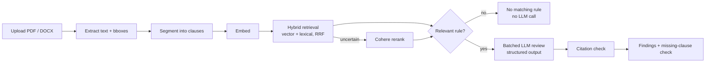

<picture>
  <source media="(prefers-color-scheme: dark)" srcset="public/logo-dark.svg">
  
</picture>

# Pleybook

**An AI contract reviewer that checks every clause against your negotiation playbook, and proves its quotes.**

Upload a contract and Pleybook splits it into clauses, finds the playbook rule that applies to each one, flags
deviations by risk level, and highlights the exact region of the PDF. Every quote the model gives is checked
against the clause text by code, not by another model, so a made-up citation is caught and downgraded.

**Live demo:** _add the deployed URL here._ The app is invite-only, so you need an account: ask the author for a guest login.
After signing in, "Try the sample MSA" runs a full review in about a minute.

<!-- Screenshot or short GIF of the split-pane review view goes here. -->

## Why it's interesting

- **Verifiable output.** Quotes are validated deterministically (exact → normalized → fuzzy match); failures are
  flagged and capped at low confidence.
- **Hybrid retrieval, not just embeddings.** Vector + lexical search fused with reciprocal rank fusion, with a
  rerank step that only runs when the first pass is unsure.
- **Finds what's missing.** A playbook rule that no clause addresses (say, no liability cap at all) becomes a
  finding. A plain "summarize the risks" prompt can't do that.
- **Measured, not claimed.** A hand-labelled gold set and an eval harness compare a naive baseline with the full
  pipeline on recall, false positives, citation validity and faithfulness (see [Evaluation](#evaluation)).
- **The demo can't hard-fail.** If every model provider is down, the sample contract still uploads (its embeddings
  are saved) and a saved review is served, clearly badged "cached". Long contracts are capped with a visible notice,
  and errors are written for people, not stack traces.
- **Works on free tiers, scales on paid ones.** Batching and a relevance pre-filter keep LLM calls few, so the
  whole thing runs well on free tiers with no credit card, and stays cheap if you move to paid plans for more
  volume. Models, providers (Gemini → Groq → OpenRouter fallback) and per-user daily caps are configuration, not
  code changes.

## How it works



| Stage | Where | Notes |
| --- | --- | --- |
| Ingest | `lib/ingest/` | `pdfjs-dist` gives text → bounding boxes; `mammoth` for DOCX; heading-aware segmenter |
| Retrieve | `lib/retrieval/` | pgvector HNSW + Postgres full-text, RRF (k=60), selective cached rerank |
| Review | `lib/llm/`, `lib/review/` | Batches of 8 clauses per structured-output call; provider fallback on any failure |
| Validate | `lib/validate/` | Span must occur in the clause or the finding is downgraded |
| Job | `lib/review/job.ts` | Advances one batch per request with an expiring lease, so no call nears the serverless limit |

### Key Architectural Decisions

- **Reviews are jobs, not requests.** A review advances one small batch per request, and progress is worked out
  from the findings already saved rather than from a counter. If a worker crashes halfway through a batch, the
  next request just redoes that batch, so a review can never get stuck.
- **Most clauses never reach the LLM.** If retrieval finds no relevant playbook rule for a clause, it is marked
  "no matching rule" straight away. Only clauses that matched something are sent to the model, and those go in
  batches of eight. That is what keeps the number of model calls low enough for free-tier rate limits, and cheap
  on paid ones.
- **Any failure moves to the next model.** Providers are tried in order (Gemini, then Groq, then OpenRouter).
  The chain moves on after a rate limit or outage, and also when a model returns malformed or incomplete
  output, so one flaky provider doesn't fail a review.
- **The reranker gets a vote, not the final say.** On the sample contract it overturned correct first-pass
  matches (it sent "unlimited liability" to the IP indemnity rule), so its ranking is blended with the
  retrieval ranking instead of replacing it.
- **The eval tests the real pipeline.** The evaluation calls the same code the app runs, not a lookalike copy,
  so the scores describe what actually ships.

## Evaluation

`npm run eval` reviews 12 synthetic contracts (45 hand-labelled deviations) two ways and writes the scores to
`eval/results/`. The signed-in `/eval` page shows them side by side, plus where each approach misses.

| | Naive baseline | Full pipeline |
| --- | --- | --- |
| Recall (labelled deviations found) | 31% (14 / 45) | **98%** (44 / 45) |
| Found *and* tied to the right rule | 18% (8 / 45) | **96%** (43 / 45) |
| False-positive rate | 11% (4 / 36 clauses) | **2%** (3 / 123 clauses) |
| Quoted text really in the clause | 100% | 100% |
| Faithfulness (LLM-judged, 12 sampled) | 92% | 92% |
| Missing clauses found | no such check | 99% recall, 98% precision |

*Naive* = fixed 600-character chunks, vector-only top-1 rule, no validation. *Full* = the pipeline described above.
Model: `gemini-3.8-flash` for both. Run of 18 Nov 2026.

**Read these numbers with care.** The contracts are synthetic and the answer key was written by the project author,
so they show relative behaviour on this set, not real-world accuracy. The LLM judge was the same model that
produced the findings, and only 12 findings per configuration were judged, so faithfulness is indicative at best.
The naive baseline's score varied between runs (31% to 38% recall); the full pipeline was steadier.

### Versus a single prompt

Every review has a **"vs. single prompt"** tab. It runs the obvious alternative on the same contract (the whole text in
one "summarize and flag the risks" call, with no playbook, retrieval or quote checking) and lines its risks up against the
pipeline's findings. A baseline risk counts as catching a finding when its quote is found inside that finding's clause.
The tab lists what the single prompt missed, which includes every missing-clause finding because it has no clause to
point at. It is one live run, so it varies; the measured comparison is the table above.

## Free-tier budget

Nothing here needs a credit card. Provider quotas change and differ per account, so this table lists what the app
spends and what stops it overspending, not the providers' current limits (check their consoles).

| Resource | What a review uses | Guard |
| --- | --- | --- |
| LLM calls | One per batch of up to 8 clauses that matched a rule; clauses with no relevant rule cost none | Gemini calls are rate-limited in-process (5 per minute); failures fall through to Groq, then OpenRouter |
| Embeddings | One batched call per upload; the sample contract's vectors are saved, so it needs none | Embedding outage shows a readable error |
| Rerank | Only for clauses where retrieval is unsure; results cached by clause and rule | Skipped silently on quota errors or with no key |
| Per user | `DAILY_REVIEW_LIMIT` reviews per rolling 24 h (default 5) | Checked before any model call |
| Per contract | `MAX_CLAUSES_PER_REVIEW` clauses (default 50) | Longer contracts are truncated with a notice |
| Hosting and data | Vercel Hobby functions, Neon free database | One batch per request keeps each call far under the 300 s limit |

The "single prompt" tab makes one extra call per click and is not counted against the daily review limit.

## Scope

**In scope:** text PDFs and DOCX; clause-by-clause review against one playbook of 12 to 15 rules; verified quotes with
PDF highlights; missing-clause detection; an evaluation harness and dashboard; invite-only access.

**Out of scope:** scanned documents (no OCR), languages other than English, multiple playbooks or editing the playbook
in the UI, redlining or suggested rewrites, multi-rule matching per clause, team or sharing features, and anything
approaching legal advice.

## Data governance

Uploads are stored in the project's Neon database, scoped to the uploading user, and the text is sent to third-party
model providers (Google, and Groq or OpenRouter when falling back) whose free tiers may log or train on prompts. Use
synthetic or public contracts only. There is no delete-my-data screen yet: documents can be removed from the database
by the operator. The sample contract and the eval contracts are synthetic.

## Tech stack

Next.js 16 (App Router, Cache Components) · React 19 · TypeScript · Tailwind CSS 4 · Neon Postgres + pgvector ·
Drizzle ORM · Better Auth · Vercel AI SDK · `react-pdf` · Vitest

## Run it locally

Needs Node 20.9+, a Neon database, and a Gemini API key (embeddings and primary LLM).

```bash
npm install
cp .env.example .env.local      # fill in DATABASE_URL, BETTER_AUTH_SECRET, BETTER_AUTH_URL, GOOGLE_GENERATIVE_AI_API_KEY
npm run db:migrate
npm run playbook:seed
npm run user:create -- alice 'a-strong-password'
npm run dev                     # http://localhost:3000 → sign in → "Try the sample MSA"
```

Optional keys: `GROQ_API_KEY` and `OPENROUTER_API_KEY` (fallback LLMs), `COHERE_API_KEY` (rerank). All variables are
documented in [`.env.example`](.env.example); production setup is in [docs/DEPLOY.md](docs/DEPLOY.md). Other commands: `npm test`, `npm run typecheck`, `npm run lint`,
`npm run eval`, `npm run demo:precompute` (regenerate the saved sample review) and `npm run verify:fallbacks`.

## Security and privacy

- **Invite-only.** No public sign-up; accounts are created from the CLI. Every API route checks the session, and
  documents are scoped to their owner.
- **Abuse limits.** Database-backed login rate limiting and a per-user daily review cap protect the LLM quota.
- **Prompt injection** is mitigated (contract text is delimited and treated as data), not eliminated.
- **Use synthetic or public contracts only.** Uploads are stored in Neon and sent to third-party model providers,
  whose free tiers may log prompts.

## Limitations

Text PDFs and DOCX only (no OCR), English only. Each clause is matched to one rule. Highlights are clause-level. A review covers at most 50 clauses (configurable).
The sample playbook is not legal advice, and neither is the output.

## License

[MIT](LICENSE.md) © 2026 Jack Munkonge
