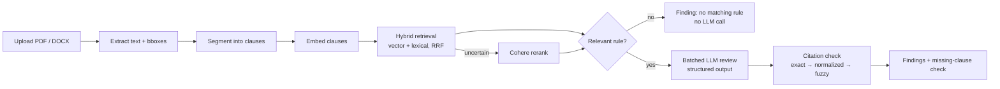

<picture>
  <source media="(prefers-color-scheme: dark)" srcset="public/logo-dark.svg">
  
</picture>

# Pleybook

**Check a contract against your negotiation playbook, clause by clause, with citations you can verify.**

Upload a contract (text PDF or DOCX). Pleybook splits it into clauses, finds the playbook rule that applies to
each one, asks an LLM whether the clause deviates, and shows the result next to the original document: risk
level, reason, and a quote that is *mechanically checked* against the clause text. Click a finding and the
matching region of the PDF is highlighted.

> **Status:** working end to end locally; production deployment and the evaluation harness are the next steps
> (see [Roadmap](#roadmap)). No accuracy numbers are published yet because none have been measured. They will
> come from the eval script, not from guesses.

<!-- Live demo: add the URL here once deployed. The app is invite-only, so also say how to request access. -->

## What it does

- **Segments** a contract into clauses with section paths and character offsets, and (for PDFs) bounding boxes.
- **Retrieves** the most relevant playbook rule per clause using vector + lexical search fused with RRF, with
  an optional rerank only when the first pass is uncertain.
- **Judges** each clause with an LLM using structured output: `none` / `low` / `medium` / `high`, a reason, and a
  verbatim quote.
- **Verifies** every quote deterministically. A quote that is not actually in the clause is flagged and its
  confidence is capped at low.
- **Finds what is missing.** A playbook rule that no clause addresses (for example, no liability cap at all)
  becomes a "missing clause" finding.
- **Shows its work.** A reasoning panel per finding exposes the rule, vector/lexical ranks, RRF score, margin,
  whether it was reranked, and which model answered.

## How it works



1. **Ingest** (`lib/ingest/`): `pdfjs-dist` text items give offset → bounding-box mapping; `mammoth` handles DOCX
   (no layout, so DOCX gets a text view). The segmenter splits on numbered headings, `Section N`, `ARTICLE`
   and lettered sub-clauses, and merges short fragments into their parent.
2. **Retrieve** (`lib/retrieval/`): top 5 by cosine similarity plus top 5 by full-text rank, fused with
   reciprocal rank fusion (k = 60). Rules are matched through their paraphrases. A relevance threshold decides
   whether a clause matches any rule at all. Cohere rerank runs only when the margin between the top two
   candidates is small or the clause is short, results are cached, and its order is blended with RRF rather than
   overriding it.
3. **Review** (`lib/llm/`, `lib/review/`): clauses that matched a rule are sent to the model in batches of 8 as one
   structured-output call. Providers are tried in order (Gemini → Groq → OpenRouter), moving on after any
   failure, including malformed output.
4. **Validate** (`lib/validate/citation.ts`): the quoted span must appear in the clause: exact match, then
   normalized (whitespace, quotes, case), then fuzzy at ≥ 0.95 token-level similarity.
5. **Review job** (`lib/review/job.ts`): a review is a job advanced one batch per request, so no single
   serverless call comes near the platform time limit and the UI can show progress.

### Design decisions

- **Batching and pre-filtering.** Free-tier LLM rate limits are the real bottleneck. Calling the model once
  per clause would be too slow, so clauses with no relevant rule skip the LLM entirely and the rest are batched.
- **Progress comes from the findings, not a counter.** The next batch is "the first clauses with no finding
  yet", guarded by an expiring lease. If a worker dies mid-batch, the work is simply redone; a review can't be
  stranded.
- **"Lexical ranking", not BM25.** Postgres `ts_rank_cd` over a `tsvector` is good for exact-term matching
  inside RRF, but it is not BM25 and isn't described as such.
- **768-dim embeddings.** Gemini embeddings are requested at 768 dimensions so the pgvector HNSW index stays
  within its 2000-dimension limit and storage stays small.
- **A failed review is not charged.** A review that errored and produced no findings does not count toward the
  daily cap.

## Tech stack

Next.js 16 (App Router, Cache Components) · React 19 · TypeScript · Tailwind CSS 4 · Neon Postgres with
pgvector · Drizzle ORM · Better Auth · Vercel AI SDK 7 · `react-pdf` / `pdfjs-dist` · Vitest.

Everything is built to run on **free tiers that need no credit card**: Vercel Hobby, Neon, Google AI Studio
(Gemini), Groq, OpenRouter (free router), and Cohere trial. Limits on those tiers change and differ per
account, so check each provider's console rather than relying on figures written here.

## Getting started

**Prerequisites:** Node.js 20.9 or newer, a Neon Postgres database, and API keys for at least one LLM provider
plus Gemini (embeddings).

```bash
npm install
cp .env.example .env.local      # then fill it in (see below)
npm run db:migrate              # creates tables, the vector extension and indexes
npm run playbook:seed           # loads data/playbook.json and embeds it
npm run user:create -- alice 'a-strong-password'
npm run dev                     # http://localhost:3000
```

Sign in, then upload a contract or click **Try the sample MSA**.

### Environment variables

| Variable | Required | Purpose |
| --- | --- | --- |
| `DATABASE_URL` | yes | Neon pooled connection string |
| `BETTER_AUTH_SECRET` | yes | 32+ chars: `openssl rand -base64 32` |
| `BETTER_AUTH_URL` | yes | Public URL of the app (`http://localhost:3000` locally; the deployed URL in production) |
| `GOOGLE_GENERATIVE_AI_API_KEY` | yes | Embeddings, and the primary LLM |
| `GROQ_API_KEY` | recommended | First fallback LLM |
| `OPENROUTER_API_KEY` | optional | Second fallback LLM |
| `COHERE_API_KEY` | optional | Selective rerank; skipped if unset or rate-limited |
| `PRIMARY_MODEL` | optional | Gemini model ID (default in `lib/llm/providers.ts`) |
| `FALLBACK_MODEL` | optional | Groq model ID |
| `OPENROUTER_MODEL` | optional | OpenRouter model, e.g. `openrouter/free` |
| `EMBED_MODEL` / `EMBED_DIM` | optional | Defaults `gemini-embedding-001` / `768`. **Do not change after clauses are embedded.** |
| `DAILY_REVIEW_LIMIT` | optional | Reviews per user per rolling 24 h (default 5) |

Model IDs change often and some become unavailable to new accounts. If reviews fail, run a one-line call
against each provider to see the real error before assuming a code bug.

### Accounts (invite-only)

There is **no public sign-up**. The sign-up endpoint is disabled, and accounts are created from the command
line:

```bash
npm run user:create -- <username> <password>   # 3-32 chars of a-z 0-9 _ .
npm run user:list
npm run user:delete -- <username>
```

Usernames and passwords are what you hand to the people you invite. Passwords are hashed by Better Auth.

## Scripts

| Command | What it does |
| --- | --- |
| `npm run dev` / `build` / `start` | Next.js dev server, production build, production server |
| `npm test` | Unit tests (Vitest) |
| `npm run typecheck` / `npm run lint` | TypeScript and ESLint |
| `npm run db:generate` / `db:migrate` | Create / apply Drizzle migrations |
| `npm run playbook:seed` | Load and embed the playbook |
| `npm run retrieve -- <doc-id \| "text">` | Debug CLI: clause → top rules with scores |
| `npm run review -- <doc-id> --user <name>` | Run a whole review from the terminal |
| `npx tsx scripts/ingest.ts <file> [--user <name>]` | Print the clause table; with `--user`, store it |
| `npm run user:create` / `list` / `delete` | Manage invite-only accounts |

## Deploying to Vercel

1. Create a Neon database and a Vercel project from this repo.
2. Add every environment variable above to the Vercel project. Set `BETTER_AUTH_URL` to the **production**
   URL, not `localhost`.
3. Against the **production** database (set `DATABASE_URL` in your shell), run:
   ```bash
   npm run db:migrate
   npm run playbook:seed
   npm run user:create -- <username> <password>
   ```
4. Deploy. The review route sets `maxDuration = 300`; Hobby functions can run that long, but check your plan.
5. Verify, logged out: `/` redirects to `/login` and `curl -i https://<app>/api/reviews` returns `401`. Then log
   in, run the sample MSA, and click a finding.

Neon suspends idle databases, so the first request after a quiet period can take a few seconds. The landing page
pings `/api/health` to wake it.

## Security

- **Invite-only, no sign-up.** Better Auth username + password; the sign-up endpoint is disabled.
- **Every API route checks the session**; the cookie check in `proxy.ts` is only an optimistic redirect and is
  not treated as a security boundary. Documents and reviews are scoped to their owner.
- **Brute-force and quota protection.** Login is rate limited (database-backed, so it works across serverless
  instances), and a per-user daily cap limits how much LLM quota one account can use.
- **Prompt injection.** Contract text is delimited and the model is told to treat it as data. A quote the model
  invents is caught by the citation check, but this is mitigation, not a guarantee.

## Data handling: read this before uploading anything

Uploaded contracts are stored in the Neon database, and their text is sent to third-party services: the
embedding and review text to Google, Groq and/or OpenRouter, and clause text to Cohere when reranking runs.
Free tiers of some providers may log prompts or use them to improve their products. **Use synthetic or public
contracts only.** Do not upload confidential or privileged documents. Check each provider's current terms.

## Limitations

- Text PDFs and DOCX only. Scanned PDFs are detected and rejected (no OCR). English only.
- Each clause is matched to its single best rule, so a clause that touches two rules is assessed against one.
- Highlights are at clause level, not at the exact quoted words.
- The playbook in `data/playbook.json` is a sample, not legal advice, and the output is not legal advice.
- Accuracy has **not** been measured yet.

## Project layout

```
app/            pages (landing, /login, /review/[id]) and API routes (documents, reviews, auth, health)
components/     PdfViewer, FindingsTable, ReasoningPanel, CoverageLine, ProviderBadge, UploadPanel, ...
lib/ingest/     PDF/DOCX extraction, clause segmenter, document storage
lib/retrieval/  hybrid search, RRF fusion, selective rerank
lib/llm/        provider chain, fallback, rate limiter, batched review
lib/review/     review job, finalization, pure view helpers
lib/validate/   citation checker
lib/db/         Drizzle schema and client
data/           playbook.json and sample contracts
drizzle/        SQL migrations
scripts/        CLIs (seed, ingest, retrieve, review, user management)
tests/          Vitest unit tests
```

## Roadmap

- [x] Foundations, auth gate, ingestion and segmentation, playbook and retrieval, review pipeline, review UI
- [ ] **Production deploy** (this branch: `production-prep`)
- [ ] **Evaluation:** a labelled gold set and `scripts/eval.ts` (clause recall, citation validity, false-positive
      rate, faithfulness) comparing a naive baseline with the full pipeline, plus an `/eval` dashboard
- [ ] **Resilience:** a precomputed demo review served if live providers fail, clause cap per review, clearer
      error states
- [ ] **Baseline comparison view** and published, measured results

## License

[MIT](LICENSE.md) © 2026 Jack Munkonge
