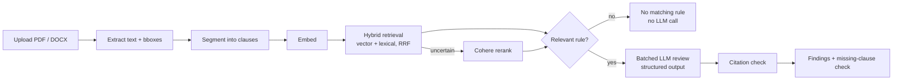

<picture>
  <source media="(prefers-color-scheme: dark)" srcset="public/logo-dark.svg">
  
</picture>

# Pleybook

**An AI contract reviewer that checks every clause against your negotiation playbook, and proves its quotes.**

Upload a contract and Pleybook splits it into clauses, finds the playbook rule that applies to each one, flags
deviations by risk level, and highlights the exact region of the PDF. Every quote the model gives is checked
against the clause text by code, not by another model, so a made-up citation is caught and downgraded.

<!-- Live demo: add the URL here. The app is invite-only, so say how to request access. -->
<!-- Screenshot or short GIF of the split-pane review view goes here. -->

## Why it's interesting

- **Verifiable output.** Quotes are validated deterministically (exact → normalized → fuzzy match); failures are
  flagged and capped at low confidence.
- **Hybrid retrieval, not just embeddings.** Vector + lexical search fused with reciprocal rank fusion, with a
  rerank step that only runs when the first pass is unsure.
- **Finds what's missing.** A playbook rule that no clause addresses (say, no liability cap at all) becomes a
  finding. A plain "summarize the risks" prompt can't do that.
- **Measured, not claimed.** A hand-labelled gold set and an eval harness compare a naive baseline with the full
  pipeline on recall, false positives, citation validity and faithfulness (see [Evaluation](#evaluation)).
- **Works on free tiers, scales on paid ones.** Batching and a relevance pre-filter keep LLM calls few, so the
  whole thing runs well on free tiers with no credit card, and stays cheap if you move to paid plans for more
  volume. Models, providers (Gemini → Groq → OpenRouter fallback) and per-user daily caps are configuration, not
  code changes.

## How it works



| Stage | Where | Notes |
| --- | --- | --- |
| Ingest | `lib/ingest/` | `pdfjs-dist` gives text → bounding boxes; `mammoth` for DOCX; heading-aware segmenter |
| Retrieve | `lib/retrieval/` | pgvector HNSW + Postgres full-text, RRF (k=60), selective cached rerank |
| Review | `lib/llm/`, `lib/review/` | Batches of 8 clauses per structured-output call; provider fallback on any failure |
| Validate | `lib/validate/` | Span must occur in the clause or the finding is downgraded |
| Job | `lib/review/job.ts` | Advances one batch per request with an expiring lease, so no call nears the serverless limit |

### Key Architectural Decisions

- **Reviews are jobs, not requests.** A review advances one small batch per request, and progress is worked out
  from the findings already saved rather than from a counter. If a worker crashes halfway through a batch, the
  next request just redoes that batch, so a review can never get stuck.
- **Most clauses never reach the LLM.** If retrieval finds no relevant playbook rule for a clause, it is marked
  "no matching rule" straight away. Only clauses that matched something are sent to the model, and those go in
  batches of eight. That is what keeps the number of model calls low enough for free-tier rate limits, and cheap
  on paid ones.
- **Any failure moves to the next model.** Providers are tried in order (Gemini, then Groq, then OpenRouter).
  The chain moves on after a rate limit or outage, and also when a model returns malformed or incomplete
  output, so one flaky provider doesn't fail a review.
- **The reranker gets a vote, not the final say.** On the sample contract it overturned correct first-pass
  matches (it sent "unlimited liability" to the IP indemnity rule), so its ranking is blended with the
  retrieval ranking instead of replacing it.
- **The eval tests the real pipeline.** The evaluation calls the same code the app runs, not a lookalike copy,
  so the scores describe what actually ships.

## Evaluation

<!-- Fill from the latest eval/results/*.json once the baseline run completes. Quote only measured numbers. -->

`npm run eval` reviews 12 synthetic contracts (45 hand-labelled deviations) two ways and writes the scores to
`eval/results/`. The signed-in `/eval` page shows naive vs full side by side, plus where each one misses.

## Tech stack

Next.js 16 (App Router, Cache Components) · React 19 · TypeScript · Tailwind CSS 4 · Neon Postgres + pgvector ·
Drizzle ORM · Better Auth · Vercel AI SDK · `react-pdf` · Vitest

## Run it locally

Needs Node 20.9+, a Neon database, and a Gemini API key (embeddings and primary LLM).

```bash
npm install
cp .env.example .env.local      # fill in DATABASE_URL, BETTER_AUTH_SECRET, BETTER_AUTH_URL, GOOGLE_GENERATIVE_AI_API_KEY
npm run db:migrate
npm run playbook:seed
npm run user:create -- alice 'a-strong-password'
npm run dev                     # http://localhost:3000 → sign in → "Try the sample MSA"
```

Optional keys: `GROQ_API_KEY` and `OPENROUTER_API_KEY` (fallback LLMs), `COHERE_API_KEY` (rerank). All variables are
documented in [`.env.example`](.env.example); production setup is in [docs/DEPLOY.md](docs/DEPLOY.md). Other commands: `npm test`, `npm run typecheck`, `npm run lint`,
`npm run eval`.

## Security and privacy

- **Invite-only.** No public sign-up; accounts are created from the CLI. Every API route checks the session, and
  documents are scoped to their owner.
- **Abuse limits.** Database-backed login rate limiting and a per-user daily review cap protect the LLM quota.
- **Prompt injection** is mitigated (contract text is delimited and treated as data), not eliminated.
- **Use synthetic or public contracts only.** Uploads are stored in Neon and sent to third-party model providers,
  whose free tiers may log prompts.

## Limitations

Text PDFs and DOCX only (no OCR), English only. Each clause is matched to one rule. Highlights are clause-level.
The sample playbook is not legal advice, and neither is the output.

## License

[MIT](LICENSE.md) © 2026 Jack Munkonge
